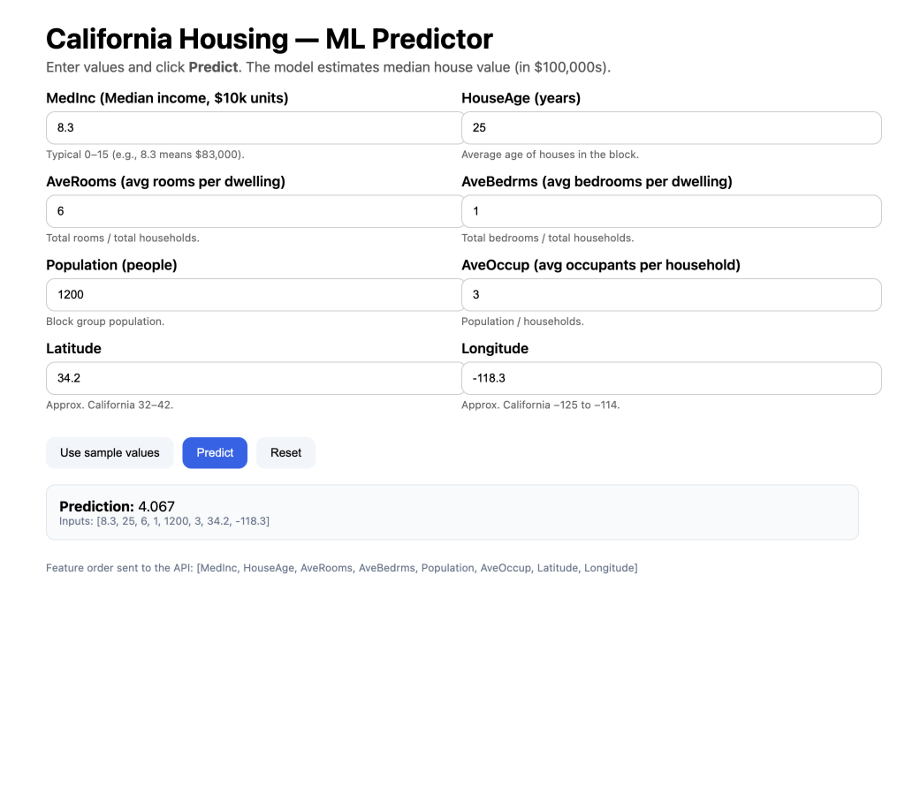

# California Housing — Model as a Service (Flask & Docker)

โปรเจกต์ให้บริการโมเดล Machine Learning (**RandomForestRegressor**) สำหรับทำนายราคามัธยฐานของบ้านในรัฐแคลิฟอร์เนีย (California Housing Dataset) ในรูปแบบ **Model as a Service (MaaS)** ผ่าน **Flask + Gunicorn** และบรรจุลงใน **Docker Container**

## วัตถุประสงค์

1. เข้าใจแนวคิดการให้บริการโมเดล Machine Learning ในรูปแบบ Model as a Service (REST API & Web UI)
2. สร้างเว็บแอปพลิเคชันด้วย Flask เพื่อรับค่าฟีเจอร์และแสดงผลการทำนาย
3. ใช้ Docker เพื่อสร้างสภาพแวดล้อมที่รันได้เหมือนกันทุกเครื่อง
4. เผยแพร่ซอร์สโค้ดและเอกสารการใช้งานบน GitHub

---

## โครงสร้างโฟลเดอร์ของโปรเจกต์

```text
ml_service/
├─ app.py                  # Flask Web Server & REST API (/health, /predict, /)
├─ train_model.py          # สคริปต์สำหรับเทรนโมเดลและบันทึกเป็น model/model.pkl
├─ requirements.txt        # รายการไลบรารี Python และเวอร์ชันที่ใช้งาน
├─ Dockerfile              # คำสั่งสร้าง Docker image และรันด้วย Gunicorn
├─ .gitignore              # กำหนดไฟล์ที่ไม่ต้อง push ขึ้น GitHub (เช่น model.pkl, .venv/)
├─ README.md               # เอกสารอธิบายโปรเจกต์ วิธี Build และวิธี Run
├─ templates/
│  └─ main.html            # หน้าเว็บสำหรับกรอกค่าฟีเจอร์และทดสอบการทำนาย
├─ screenshots/
│  └─ prediction.png       # ภาพหน้าจอผลการทำนายจากหน้าเว็บ
└─ model/
   └─ model.pkl            # ไฟล์โมเดลที่เทรนแล้ว (สร้างอัตโนมัติเมื่อรัน train_model.py)
```

---

## วิธีการ Build และ Run ด้วย Docker

### 1. Build Docker Image

```bash
docker build -t ds-ml-service .
```

> ระหว่างขั้นตอน `docker build` ระบบจะติดตั้ง dependencies จาก `requirements.txt` และรัน `python train_model.py` เพื่อสร้างไฟล์ `model/model.pkl` ภายใน image โดยอัตโนมัติ

### 2. Run Docker Container

```bash
docker run --rm -p 5000:5000 ds-ml-service
```

> **หมายเหตุ:** หากพอร์ต `5000` ถูกใช้งานอยู่ (เช่น AirPlay Receiver บน macOS) สามารถเปลี่ยนพอร์ตฝั่ง Host เป็น `8080` ได้ด้วยคำสั่ง:
> ```bash
> docker run --rm -p 8080:5000 ds-ml-service
> ```
> แล้วเข้าใช้งานผ่าน `http://127.0.0.1:8080/` แทน

### 3. เปิดใช้งานผ่านเว็บเบราว์เซอร์

- **หน้าเว็บสำหรับทำนายผล:** `http://127.0.0.1:5000/`
- **ตรวจสอบสถานะระบบ:** `http://127.0.0.1:5000/health`

---

## วิธีการรันแบบ Local (Virtual Environment)

หากต้องการรันหรือทดสอบบนเครื่องโดยตรงด้วย Python 3.11 (`.venv`):

```bash
# 1. สร้างและเปิดใช้งาน Virtual Environment (Python 3.11)
python3.11 -m venv .venv
source .venv/bin/activate        # macOS / Linux
# .venv\Scripts\Activate.ps1     # Windows PowerShell

# 2. ติดตั้ง dependencies
pip install -r requirements.txt

# 3. เทรนและบันทึกโมเดล
python train_model.py

# 4. รันเว็บแอปพลิเคชันด้วย Gunicorn (หรือ python app.py สำหรับโหมด debug)
gunicorn -w 2 -b 0.0.0.0:5000 app:app
```

---

## เอกสารการใช้งาน API

### 1. Health Check (`GET /health`)

ตรวจสอบความพร้อมของบริการและลำดับฟีเจอร์ที่โมเดลต้องการ

**ตัวอย่างคำตอบ:**
```json
{
  "ok": true,
  "features": [
    "MedInc",
    "HouseAge",
    "AveRooms",
    "AveBedrms",
    "Population",
    "AveOccup",
    "Latitude",
    "Longitude"
  ]
}
```

### 2. Prediction (`POST /predict`)

ส่งค่าฟีเจอร์ทั้ง 8 ตัวในรูปแบบ JSON Array (หน่วยผลลัพธ์เป็น `$100,000s`)

**คำอธิบายฟีเจอร์ทั้ง 8 ตัว:**
1. `MedInc` — รายได้มัธยฐานของครัวเรือนในบล็อก (หน่วย `$10,000` เช่น `8.3` = `$83,000`)
2. `HouseAge` — อายุเฉลี่ยของบ้านในบล็อก (ปี)
3. `AveRooms` — จำนวนห้องเฉลี่ยต่อครัวเรือน
4. `AveBedrms` — จำนวนห้องนอนเฉลี่ยต่อครัวเรือน
5. `Population` — จำนวนประชากรในบล็อก
6. `AveOccup` — จำนวนผู้อยู่อาศัยเฉลี่ยต่อครัวเรือน
7. `Latitude` — ละติจูด (ช่วงแคลิฟอร์เนียประมาณ `32` ถึง `42`)
8. `Longitude` — ลองจิจูด (ช่วงแคลิฟอร์เนียประมาณ `-125` ถึง `-114`)

**ทดสอบด้วย `curl` (macOS / Linux):**
```bash
curl -X POST http://127.0.0.1:5000/predict \
  -H "Content-Type: application/json" \
  -d '{"features":[8.3,25.0,6.0,1.0,1200,3.0,34.2,-118.3]}'
```

**ทดสอบด้วย PowerShell (Windows):**
```powershell
Invoke-RestMethod -Uri http://127.0.0.1:5000/predict -Method Post -ContentType "application/json" -Body '{"features":[8.3,25.0,6.0,1.0,1200,3.0,34.2,-118.3]}'
```

**ตัวอย่างผลลัพธ์ที่ได้:**
```json
{
  "prediction": 4.066552199999995
}
```
> ค่าทำนาย `4.067` (หน่วย `$100,000s`) หมายถึงราคาบ้านมัธยฐานประมาณ **\$406,700** (ทศนิยมตำแหน่งท้าย ๆ อาจต่างกันเล็กน้อยตามเวอร์ชันของ `scikit-learn` และสภาพแวดล้อม)

---

## ภาพหน้าจอผลการทดสอบบนเว็บเบราว์เซอร์


